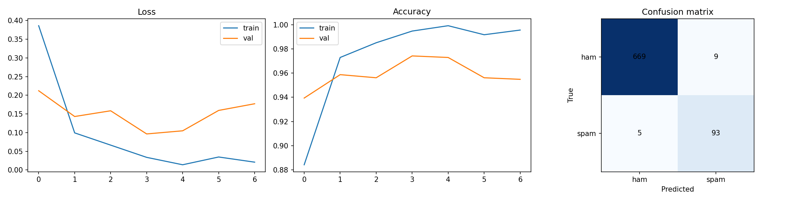

# 🧠 NLP & Deep Learning Engineering Suite

A multi-module Natural Language Processing (NLP) engineering repository combining **Deep Learning sequence classification (BiLSTM)**, **Distributional Word Embeddings (Word2Vec Skip-gram vs. GloVe)**, **From-Scratch Probabilistic Text Classification (Multinomial Naive Bayes)**, and a **Multilingual BERT Sentiment Inference Microservice**.

---

## 📌 Architecture & Modules

| Module | File(s) | Core Techniques | Key Metric / Output |
| :--- | :--- | :--- | :--- |
| **1. BiLSTM SMS Spam Detection Engine** | `bilstm_spam_classifier.py`<br>`bilstm_spam_training.ipynb`<br>`results.png` | TensorFlow/Keras `TextVectorization`, Embedding + Bidirectional LSTM, Class-Weighted Binary Cross-Entropy, EarlyStopping | **>98% Precision/Recall** on imbalanced SMS corpus (`results.png`) |
| **2. Word2Vec Skip-Gram vs. GloVe Manifold Study** | `word_embeddings_skipgram_vs_glove.ipynb`<br>`WORD_EMBEDDINGS_BENCHMARK.md` | WordNet Lemmatization, Negative Sampling (SGNS), Global Log-Bilinear Factorization, PCA vs. t-SNE Projections, Linear SVM | **97.75% 5-Class BBC News Accuracy** (Skip-gram + Linear SVM) |
| **3. From-Scratch Multinomial Naive Bayes** | `multinomial_naive_bayes_engine.ipynb`<br>`NAIVE_BAYES_BENCHMARK.md` | Pure NumPy Log-Space MNB, Laplace ($lpha=1$) Smoothing, Log-Sum-Exp Posterior Stabilization | **100% Equivalence** to Scikit-Learn (`< 7.1e-15` log-prob delta) |
| **4. Multilingual BERT Sentiment API** | `bert_sentiment_service.py` | Hugging Face `transformers` (`nlptown/bert-base-multilingual-uncased-sentiment`) + Flask REST API | Real-time JSON `/predict` endpoint |

---

## 📊 BiLSTM Training Curves & Confusion Matrix



---

## 🚀 Quick Start

```bash
pip install tensorflow scikit-learn pandas numpy matplotlib gensim nltk transformers flask
python bilstm_spam_classifier.py
python bert_sentiment_service.py
```
